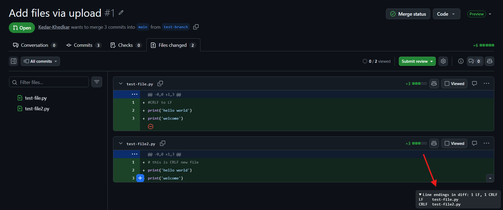

# GitHub hides CRLF line endings from you. This extension shows them.

A pull request changes one line in a file, but the diff shows every line as changed. Both versions look identical, because the only difference is that every line now ends in `\r\n` instead of `\n`.

GitHub shows LF and CRLF files exactly the same way, so you can't tell them apart. I built a small Chrome extension that tells you: [GitHub Line Endings](https://github.com/Kedar-Khedkar/Github-line-endings).

## What are LF and CRLF line endings?

A line ending is the invisible character that marks the end of each line in a text file.

- **LF** (`\n`) is the standard on Linux and macOS.
- **CRLF** (`\r\n`) is the standard on Windows.

Most editors handle both quietly, which is why a mismatch usually goes unnoticed until something breaks.

## Why line endings cause problems

- **Noisy diffs.** An editor converts a file to CRLF, and the next PR shows all 400 lines as changed. The real change is buried somewhere inside.
- **Broken shell scripts.** A `.sh` file with CRLF endings fails on Linux with `/bin/bash^M: bad interpreter`.
- **Lost history.** After a file is converted, `git blame` points at whoever converted it, not whoever wrote the code.

## What the extension shows

A small box appears in the bottom-right corner of GitHub.

 

On a **file page**, it shows the file's line endings:

```
Line endings: LF
Line endings: CRLF
Line endings: Mixed (3 CRLF, 40 LF)
```

On a **pull request**, it shows a summary, then each changed file:

```
Line endings in diff: 1 CRLF, 4 LF
LF    src/app.js
LF    src/util.js
CRLF  scripts/deploy.sh
LF    README.md
LF    package.json
```

That `CRLF  scripts/deploy.sh` line is the one that would have broken your deploy.

Click the summary line to collapse the list so it stays out of the way while you review. Images, PDFs and other binary files are skipped.

## How it works

GitHub's page doesn't contain the line endings, so the extension downloads the raw file (or the PR's diff) from GitHub and counts how many lines end in `\r\n` versus `\n`.

It uses your existing GitHub login, so private repos work too. Nothing is sent anywhere else.

## How to install it

The extension isn't on the Chrome Web Store yet, so you load it yourself. It takes about a minute.

1. Download the code:

   ```bash
   git clone https://github.com/Kedar-Khedkar/Github-line-endings.git
   ```

2. Open `chrome://extensions` (or `edge://extensions` in Edge) and turn on **Developer mode**.
3. Click **Load unpacked** and select the downloaded folder.
4. Open any file or pull request on github.com.

There's nothing to configure.

## Limitations

- On pull requests, it only checks the lines shown in the diff, not the whole file. Open the file page for the full answer.
- It only works on github.com, not GitHub Enterprise or GitLab.

## FAQ

### How do I check line endings locally?

Run this in your repo. It lists each file's line endings (`lf`, `crlf` or `mixed`):

```bash
git ls-files --eol
```

### How do I make a repo use LF everywhere?

Add a `.gitattributes` file at the repo root:

```
* text=auto eol=lf
```

Then convert the files that are already committed:

```bash
git add --renormalize .
git commit -m "Normalize line endings to LF"
```

Expect a large diff, so put it in a commit of its own.

## Try it

The code is on GitHub at [Kedar-Khedkar/Github-line-endings](https://github.com/Kedar-Khedkar/Github-line-endings). It's under 100 lines of JavaScript, so you can read all of it before installing.

Next time a PR shows 400 changed lines for a one-line fix, check the bottom-right corner first. If the extension gets something wrong, open an issue with the link.
